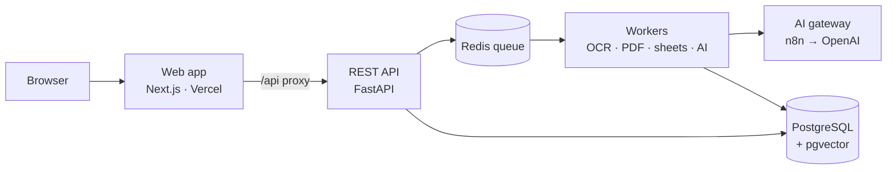

# DocIntel: AI document intelligence

DocIntel reads invoices, receipts, scanned PDFs, phone photos, TIFF, Excel and CSV files. It extracts the invoice data
with AI, **proves every value against the document**, checks all the arithmetic, finds duplicates and differences
between documents, sends only the unsure cases to a person, and makes everything searchable and exportable.

## Try the live demo

| | |
|---|---|
| **Live demo** | https://docintel-invoice-ai.vercel.app |
| **Access code** | sent with the application email (the demo is locked without it) |
| **API docs** | https://docintel-invoice-ai.vercel.app/api/docs (enter the code in the `X-Access-Code` field of any endpoint) |

**First two minutes:** enter the access code → **Upload** → **Process all sample files** (12 prepared files: digital and scanned
PDFs, phone photos, TIFF, Excel, CSV, a broken file) → wait a minute or two → **Review queue** → open an invoice.
Step-by-step guide: [docs/05-how-to-use.md](docs/05-how-to-use.md).

The code is not stored in this repository. The web app asks for it again in every new browser session, and the
**Lock demo** button in the sidebar locks it straight away. A daily AI budget on the server limits the cost, and the
code can be changed at any time (`ACCESS_CODES` on the server).

| | |
|---|---|
| **Inputs** | PDF (text or scanned, up to 1,500 pages, many invoices per file), JPG, PNG, multi-page TIFF, XLSX (every sheet), XLS, CSV (any delimiter and number format) |
| **Extracts** | invoice number, date, supplier, customer, subtotal, tax, total, currency, line items: structured JSON, each value with its source quote and confidence |
| **Never invents** | no proof in the document → the field stays empty and is flagged; ambiguous dates are never guessed |
| **Checks** | missing fields, impossible amounts, subtotal + tax = total, line items = subtotal, quantity × price, future and ambiguous dates, duplicate invoices and files, PDF ↔ PDF and PDF ↔ Excel differences |
| **People** | review queue, side-by-side page and data, plain "What to do" for every problem, corrections with full history, approval |
| **Find** | keyword, semantic (meaning) and hybrid search with filters; Excel export of everything or any filtered view |
| **Runs reliably** | background workers, automatic retries, resumable jobs, automatic recovery of stuck jobs, system health page |

## Measured results

From the latest evaluation on a labelled dataset (96 files, 141 invoices: digital PDFs, scans, phone photos, very
poor photos, TIFF, batch PDFs, Excel, XLS, CSV, broken and locked files, and 55 planted problems), run against the
live system. Full report: [docs/08-evaluation-report.md](docs/08-evaluation-report.md).

| Metric | Result |
|---|---|
| Field accuracy (8 fields × 141 invoices) | **100.0 %** |
| Invoices with every field correct | 100.0 % |
| Invoices found (incl. splitting multi-invoice PDFs and TIFFs) | 141 / 141 |
| Values invented where nothing was printed | **0** |
| Planted problems caught (wrong totals, duplicates, conflicts, missing fields…) | **55/55** |
| Valid files processed / failure rate | 100.0 % / 0.0 % |
| Broken or locked files stopped with a clear reason | 100.0 % of 6 |
| Median time per file (incl. OCR and AI) | 5.0 s (scans ≈ 15 s: read twice) |
| 1,000-page batch PDF | 1,000 pages, 789/789 invoices found, 100.0 % field accuracy, 17.3 min |
| Automated tests | 93 passed, 87 % line coverage |

## How it works



1. **Check the file**: the type comes from the file's bytes, not its name; damaged, empty and locked files stop
   with a clear reason.
2. **Read**: text PDFs are read directly; scans and photos are rotated, straightened and cleaned, then OCR'd with
   Tesseract; every Excel sheet is read and columns are mapped without AI.
3. **Split**: long PDFs and multi-page TIFFs are split into separate invoices.
4. **Extract**: an AI model fills a strict JSON form and must quote its source for every value. **Scans are read
   twice** (OCR text and page image, independently) and the readings are reconciled.
5. **Prove and check**: code verifies each quote and value; unproven values are removed; all validation rules,
   duplicate and cross-document checks run.
6. **Index**: full-text and vector search; results, problems and the full processing history are stored.

Details: [architecture](docs/02-architecture.md) · [database schema](docs/03-database-schema.md) ·
[API](docs/04-api-reference.md).

## Quick start

```bash
cp .env.example .env              # add OPENAI_API_KEY
docker compose up -d --build      # API, 2 workers, PostgreSQL + pgvector, Redis
open http://localhost:8000/api/docs

cd frontend && cp .env.example .env.local && npm install && npm run dev   # http://localhost:3000
```

Full instructions and all settings: [docs/06-setup-and-deployment.md](docs/06-setup-and-deployment.md).

## Documentation

| Document | Contents |
|---|---|
| [00 Assignment](docs/00-assignment.md) | The brief this project answers |
| [01 Requirements checklist](docs/01-requirements-checklist.md) | Every requirement → where it is implemented → evidence |
| [02 Architecture](docs/02-architecture.md) | Components, pipeline, design decisions, scaling |
| [03 Database schema](docs/03-database-schema.md) | Tables, ER diagram, indexes, search |
| [04 API reference](docs/04-api-reference.md) | Endpoints, examples, JSON shape, errors |
| [05 How to use](docs/05-how-to-use.md) | The screens, a typical session, reading results, errors |
| [06 Setup and deployment](docs/06-setup-and-deployment.md) | Local run, configuration, production deployment |
| [07 Testing](docs/07-testing.md) | Test suite, coverage, bugs found and fixed |
| [08 Evaluation report](docs/08-evaluation-report.md) | Dataset, method, measured accuracy and speed, run history |
| [09 AI prompts and disclosure](docs/09-ai-prompts-and-disclosure.md) | Prompts verbatim, schema, AI-assisted development |
| [10 Security](docs/10-security.md) | Access, transport, uploads, secrets, audit |
| [11 Operations and recovery](docs/11-operations-and-recovery.md) | Failure handling, recovery, runbook, monitoring |
| [12 Limitations and roadmap](docs/12-limitations-and-roadmap.md) | Honest limits and next steps |

## Repository

```
backend/      FastAPI API, processing pipeline, workers, tests (pytest), Dockerfile
frontend/     Next.js web app (deployed on Vercel)
dataset/      labelled dataset generator and demo sample files
evaluation/   evaluation script, latest results and the history of runs
n8n/          AI gateway workflow (keeps the OpenAI key out of the code)
deploy/       production overlay (HTTPS, limits) and deployment scripts
docs/         documentation
```

## Built with AI assistance

Built by **Md Asif**, verified by the automated tests and the
measured evaluation. Disclosure and prompts: [docs/09-ai-prompts-and-disclosure.md](docs/09-ai-prompts-and-disclosure.md).
