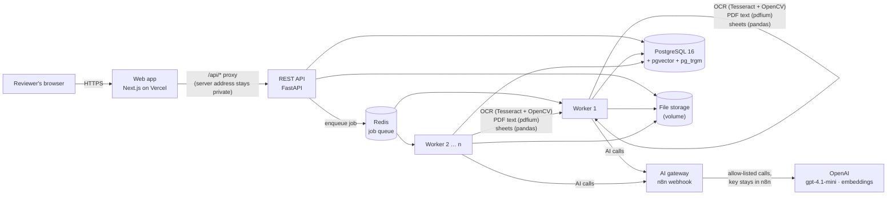
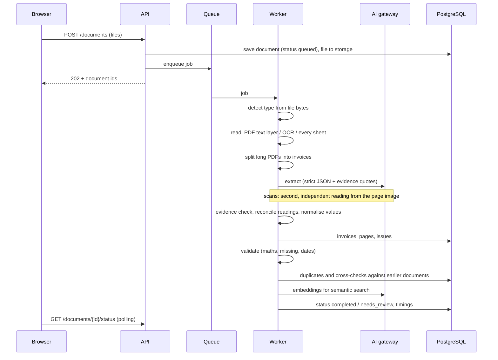

# Architecture

## System overview

| Part | Technology | Why this choice |
|---|---|---|
| Web app | Next.js 16 (React 19), deployed on Vercel | The brief asks for React or Next.js. Vercel gives global HTTPS hosting; its `/api/*` rewrite forwards API calls, so browsers only ever talk to one origin and the processing server's address is not exposed. |
| API | Python 3.12, FastAPI, Pydantic | The best OCR and spreadsheet libraries are Python, so the API and pipeline share one language and one data model. FastAPI generates the interactive OpenAPI documentation. (The brief suggests Node/NestJS but allows alternatives.) |
| Background work | Redis + RQ workers | Upload returns at once (HTTP 202); OCR and AI run in workers. Workers scale horizontally (`replicas`). RQ gives timeouts, failure callbacks and registries used by the recovery sweeper. |
| OCR | Tesseract 5 (LSTM) + OpenCV | Free, runs locally (documents are not sent anywhere for OCR). OpenCV fixes orientation (90/180/270°), straightens small tilts, improves contrast and removes noise; a second, stronger clean-up pass runs when Tesseract is unsure. |
| PDF text | pypdfium2 (PDFium) | Exact text from digital PDFs, page by page; pages without a text layer are rendered and sent to OCR, so mixed PDFs work. |
| Spreadsheets | pandas, openpyxl (XLSX), xlrd (XLS), charset-normalizer + csv.Sniffer (CSV) | Every sheet is read. Header detection maps columns such as "Bill No", "Vendor", "Grand Total" to invoice fields without AI (exact and free). |
| AI | OpenAI `gpt-4.1-mini` (text and vision), `text-embedding-3-small` | Strict JSON-schema output, low cost and fast. Called through an n8n webhook that holds the API key and allows only two endpoints. A direct-OpenAI mode exists for anyone running the repo. |
| Database | PostgreSQL 16 + pgvector + pg_trgm | One database for records, processing history, full-text search (tsvector), fuzzy name search (trigram) and semantic search (HNSW vector index). Fewer moving parts than a separate vector database. |

## The pipeline (one document)

Every stage writes a row to `processing_events` with its duration, so the history of each document is visible in
the UI and the API.

## Key design decisions

1. **The model never decides alone.** It must quote the document for every value (`evidence`). Code then checks
   that the quote appears in the document text (exactly, or ≥ 88 % similar for OCR text) and that the value appears
   inside the quote. Otherwise the value is set to `null`, the AI's suggestion is kept only for the reviewer, and the
   invoice goes to review. An ambiguous printed date (03/04/2026) is never resolved silently.
2. **Maths is code, not AI.** Subtotal + tax = total, quantity × unit price = line amount, line items = subtotal:
   exact `Decimal` arithmetic with a 2-cent tolerance plus half a cent per line for rounding. No percentage
   tolerance, so a wrong total on a large invoice is still caught.
3. **Two independent readings for scans.** For scanned pages and photos the invoice is read twice: once from the
   OCR text, once from the page image only (the OCR text is deliberately not shown, so the second reading cannot
   copy an OCR mistake). Values that agree are confirmed. Amount disagreements are settled by the arithmetic.
   Anything still unresolved is flagged with both readings.
4. **Spreadsheets without AI where possible.** Column headers are mapped by synonyms and fuzzy matching. Each row
   becomes an invoice record with cell-level evidence (`Invoices!G12`). Line-item sheets join by invoice number.
   Sheets laid out like a printed form go to the AI.
5. **Duplicates vs. cross-checks.** The same invoice in two invoice documents with equal values = duplicate
   (flagged on the later copy). Different values = conflict. An invoice and a ledger row = cross-check (match or
   mismatch).
6. **Resumable, recoverable jobs.** AI answers are cached by (prompt version, model, document text, image bytes). A
   job restarted after a crash or deploy reuses finished work. A recovery sweeper requeues documents whose worker
   died, and a failure callback marks timeouts. Workers finish their current document before a restart (2-minute
   grace period).
7. **One origin for the browser.** The web app calls `/api/*` on its own domain; Vercel forwards to the processing
   server. No CORS in normal use, no server address in the browser, and the access code travels in a header, never
   in URLs (except an optional one-time `?code=` link that the app removes from the address bar).

## Scaling

| Pressure | What to do (no code changes) |
|---|---|
| More files per hour | Increase worker `replicas`; each worker processes one document, and AI calls inside a document run in parallel (`AI_CONCURRENCY`). |
| Long PDFs | Split into invoices automatically; extraction runs in parallel; cached answers make restarts cheap. |
| More API traffic | Run several API containers behind the proxy; they are stateless. |
| More data | Managed PostgreSQL; the HNSW index keeps semantic search fast; originals can move to S3-compatible storage. |
| AI rate limits | Raise the provider tier or `AI_CONCURRENCY`; the daily call budget (`AI_DAILY_CALL_LIMIT`) protects cost. |

## Deployment used for the demo

| Component | Where |
|---|---|
| Web app | Vercel project `docintel-demo` → https://docintel-invoice-ai.vercel.app |
| API, workers, PostgreSQL, Redis, file storage | Docker Compose on a Hostinger VPS behind Traefik (HTTPS, Let's Encrypt). Hard CPU and memory limits per container (see `deploy/docker-compose.server.yml`). |
| AI gateway | An n8n workflow (export in `n8n/ai-gateway.workflow.json`). |
