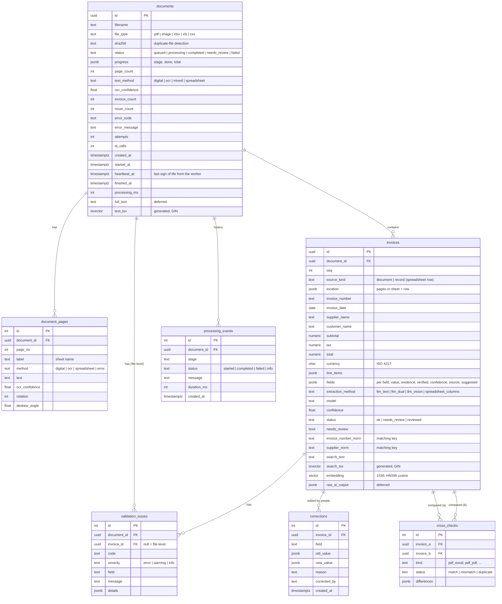

# Database schema

PostgreSQL 16 with the `vector` (pgvector) and `pg_trgm` extensions. Tables are defined in
[`backend/app/models.py`](../backend/app/models.py) and created at start-up (`init_db`, idempotent, with small
forward-only migrations).

## Indexes and search

| Index | Purpose |
|---|---|
| `documents(sha256)`, `documents(status)`, `documents(created_at)` | duplicate files, list filters, ordering |
| `documents.text_tsv` (GIN) | keyword search inside every page of every document |
| `invoices.search_tsv` (GIN) | keyword search over invoice number, parties, items, totals |
| `invoices.supplier_name` (GIN, trigram) | fuzzy supplier search ("Northwnd" still finds "Northwind") |
| `invoices.embedding` (HNSW, cosine) | semantic search ("medical gloves" finds "Nitrile gloves, box of 100") |
| `invoices(invoice_number_norm)`, `invoices(supplier_norm)` | duplicate and cross-document matching |

**Hybrid search** ranks keyword and semantic results with Reciprocal Rank Fusion (k = 60), so results that match
both the words and the meaning come first.

## Why each table exists (requirement mapping)

| Brief asks to store | Where |
|---|---|
| Document metadata | `documents` |
| Extracted text | `document_pages.text`, `documents.full_text` |
| Structured results | `invoices` (columns + `fields` with evidence and confidence + `line_items`) |
| Validation errors | `validation_issues` |
| Processing history | `processing_events` (every stage with duration), `corrections` (every manual change) |
